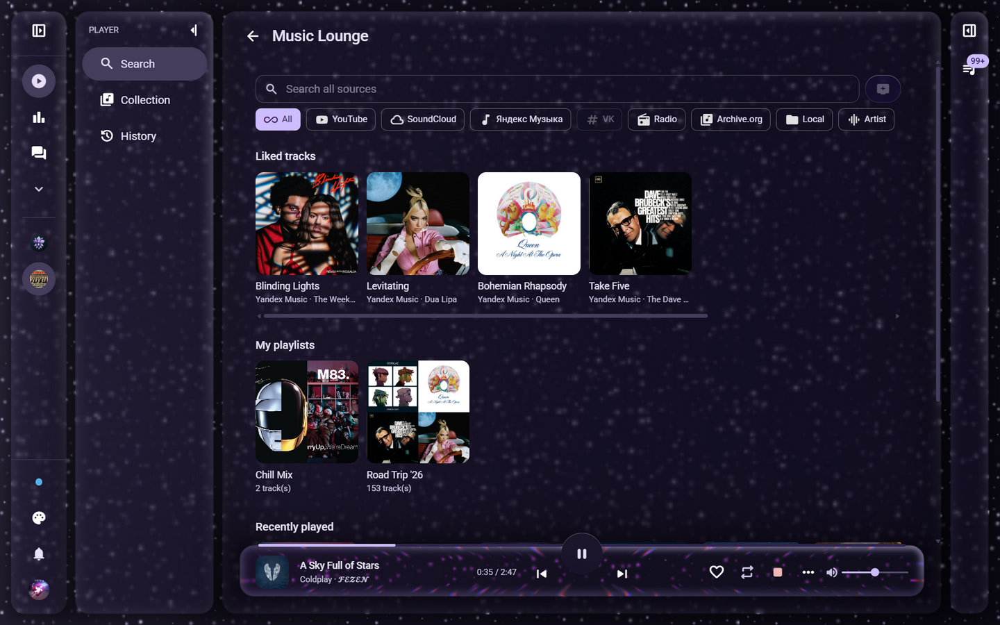
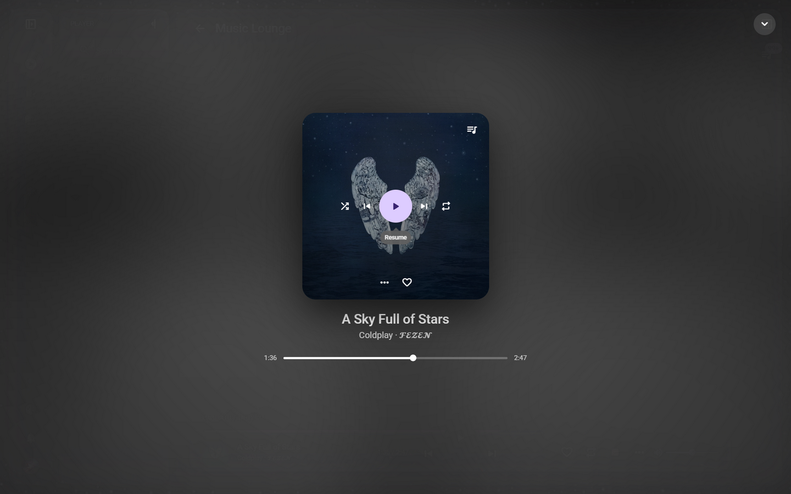

<div align="center">

# discord_complex_bot

**A self-hosted Discord music bot with a full web panel.**

Music from every major source in your voice channels — controlled from slash
commands or from a browser that looks and feels like a streaming app.

[](https://www.python.org/)
[](https://discordpy.readthedocs.io/)
[](https://fastapi.tiangolo.com/)
[](https://react.dev/)
[](https://lavalink.dev/)
[](https://docs.docker.com/compose/)
[](LICENSE)

*[Screenshots](#screenshots) · [Features](#features) · [Architecture](#architecture) · [Quick start](#setup) · [Development](#development)*



</div>

## Screenshots

| Player | Now playing |
| --- | --- |
|  |  |

The panel runs on a custom **"Liquid Glass"** theme family (WebGL refraction
backdrop, aurora mesh, god rays) with regular flat themes as the fallback.

## Features

| | |
| --- | --- |
| 🎧 **Sources** | YouTube, SoundCloud, Yandex Music, internet radio, Archive.org and a local audio folder — plus an **All** search that queries every source at once and flags HLS-only and DRM-protected tracks. |
| 📃 **Queue** | Search results, single URLs and whole **playlists** (YouTube mixes, SoundCloud sets, Yandex playlists and albums). Tracks resolve lazily right before playback, so big playlists queue instantly; dead entries skip themselves instead of stalling the queue. |
| ✨ **Playback extras** | Sleep timer with fade-out, sound-effect presets (nightcore, x1.5 speed, bass boost, 8D, karaoke…), synced **karaoke lyrics** on the now-playing screen, vote-skip, and a full-screen now-playing view with a seek bar. |
| 📻 **Autoplay** | When the queue runs dry the bot starts a radio station that matches a configurable query (for example `lofi`). |
| ⭐ **Library** | Private per-user favorites, personal playlists, one-click import of external playlists, "save the current queue as a playlist". |
| 🖥️ **Web panel** | Live player (websocket push), drag-and-drop queue management, per-server statistics, notification feed, and a **Liquid Glass** UI. |
| 🛠️ **Moderation & posts** | Publish from the panel or with `/post` and `/announce` — forum channels get real threads. The composer has a Discord-markdown toolbar, mentions, server emojis and a live preview. |
| 🔐 **Roles** | Regular members control the player; server admins (and the super-admin from `.env`) manage settings, stats, posts and per-action player permissions. |
| 📊 **Monitoring** | A built-in availability monitor samples every service (Discord, Lavalink, sources) once a minute with hourly/daily/monthly charts on the About page. |

Not every YouTube video is playable from every network — the panel probes
search results and tells you about HLS/DRM limits before you queue a track.

## Architecture

```text
[Web panel (React SPA)] ──HTTP──▶ [FastAPI ──┐
[Discord clients] ──Gateway──▶   discord.py  ├─▶ [SQLite (settings, history, sessions)]
                                 wavelink ────┼─▶ [Lavalink] ──▶ YouTube / SoundCloud /
                                              └─Voice UDP─▶  Yandex Music / radio / …
```

Four containers ship with Docker Compose:

| Container | Role |
| --- | --- |
| `app` | One asyncio process: the discord.py bot **and** the FastAPI panel + websocket API |
| `web` | nginx serving the built React SPA and proxying `/api` |
| `lavalink` | Lavalink v4 with the youtube-source (OAuth) and LavaSrc (Yandex) plugins |
| `vk-resolver` | Optional headless-browser sidecar that resolves VK tracks without a VK API token (signed CDN URLs, covers, anti-ban pacing) |

## Setup

### 1. Discord application

1. Create an application in the
   [Discord Developer Portal](https://discord.com/developers/applications).
2. **Bot** tab: copy the token into `DISCORD_BOT_TOKEN`. No privileged
   gateway intents are required.
3. **OAuth2**: copy the client id and client secret. Add a redirect URI that
   matches `DISCORD_REDIRECT_URI` (default
   `http://localhost:8000/api/auth/callback`).
4. Invite the bot with the scopes `bot applications.commands identify guilds`.

### 2. Lavalink sources

The bundled [`lavalink/application.yml`](lavalink/application.yml) enables the
`youtube-source` plugin (with OAuth support) and the `LavaSrc` plugin for
Yandex Music.

- **YouTube**: playback from datacenter/hosted networks needs the OAuth
  refresh token of the youtube-source plugin. Put it into
  `YOUTUBE_REFRESH_TOKEN` or set it later on the panel's System settings page.
  Residential networks usually play fine without it.
- **Yandex Music**: set `YANDEX_MUSIC_ENABLED=true` and paste a Yandex OAuth
  token into `YANDEX_MUSIC_TOKEN` (a Plus subscription is recommended). The
  panel can save it at runtime.

### 3. Configure

```bash
cp .env.example .env
# edit .env: bot token, client id/secret, session secret, super-admin ids
```

| Variable | Purpose |
| --- | --- |
| `DISCORD_BOT_TOKEN` | Bot token from the Developer Portal |
| `DISCORD_CLIENT_ID` / `DISCORD_CLIENT_SECRET` | OAuth2 credentials |
| `DISCORD_REDIRECT_URI` | Must match a registered OAuth2 redirect |
| `SUPERADMIN_IDS` | Space-separated Discord ids with full panel access |
| `SESSION_SECRET` | Secret for signing session cookies |
| `BASE_URL` | Public URL of the panel, used in OAuth links |
| `DATABASE_URL` | SQLite path (`/data/bot.db` in Docker) |
| `LAVALINK_*` | Lavalink host, port, password, TLS |
| `YOUTUBE_REFRESH_TOKEN` | Optional youtube-source OAuth token |
| `YANDEX_MUSIC_ENABLED` / `YANDEX_MUSIC_TOKEN` | Yandex Music source |
| `VK_RESOLVER_URL` | Address of the VK sidecar (compose wires it automatically) |
| `MUSIC_LIBRARY_DIR` | Local audio library folder (`data/music`) |
| `INTERNAL_BASE_URL` | Address Lavalink uses to reach the app (compose: `http://app:8000`) |

### 4. Run

```bash
docker compose up -d --build
docker compose run --rm app alembic upgrade head   # first run only
```

Open `http://localhost:8000`, log in with Discord and add the bot to your
server. Drop audio files into `data/music` to use the Local source.

To expose the panel publicly, put it behind a reverse proxy or forward a port,
then point `BASE_URL` and `DISCORD_REDIRECT_URI` at your domain (and add the
callback to the Discord redirect list).

## Development

```bash
python -m venv .venv
.venv/Scripts/pip install -e ".[dev]"     # Linux/macOS: .venv/bin/pip
.venv/Scripts/python -m pytest -q         # tests use a tmp sqlite database

# frontend with hot reload (proxies /api to :8000)
cd web && npm install && npm run dev

# backend
.venv/Scripts/python -m app.main
```

Database schema changes: edit the models, generate a migration with
`alembic revision --autogenerate`, then run `alembic upgrade head` in the
container.

## Project structure

```text
app/
  bot/            # discord.py client + cogs (music, moderation, owner, posts)
  api/            # FastAPI routers: auth, player, admin, favorites, posts, library
  core/           # config, SQLAlchemy models + Alembic, services (music, library, …)
  main.py         # one asyncio loop runs the bot and the API
  static/         # built frontend (git-ignored)
web/              # React SPA sources (Vite + MUI)
vkresolver/       # VK sidecar: Playwright session that captures signed CDN URLs
lavalink/         # Lavalink application.yml
alembic/          # database migrations
tests/            # pytest suite (tmp sqlite, no real credentials)
data/             # runtime state: sqlite db, local music library (git-ignored)
```

## Roadmap

Planned work lives in [ROADMAP.md](ROADMAP.md). The versioning scheme and the
full change history are on the panel's **About → Changelog** tab
([web/src/changelog.ts](web/src/changelog.ts)).

## License

[MIT](LICENSE)
